<p align="center">
  <a href="https://mywestlord.github.io/touch-gregg/">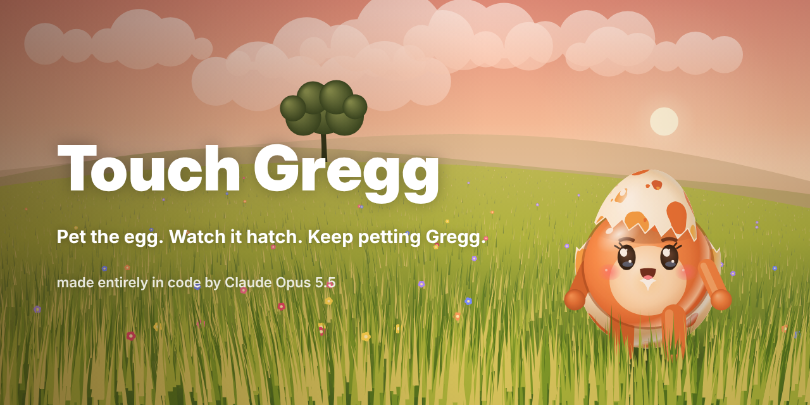</a>
</p>

<h1 align="center">Touch Gregg</h1>

<p align="center">
  <b>The (unofficial) Claude Code mascot. Pet the egg. Watch it hatch. Keep petting Gregg.</b>
</p>

<p align="center">
  <a href="https://mywestlord.github.io/touch-gregg/"></a>
  
  
  
</p>

<p align="center">
  <a href="https://mywestlord.github.io/touch-gregg/">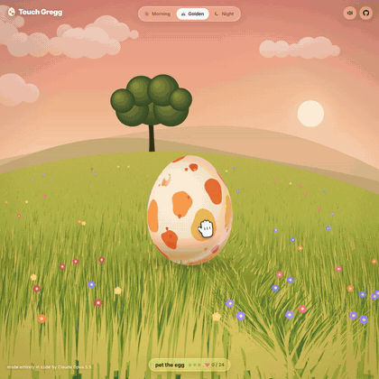</a>
</p>

---

## Meet Gregg

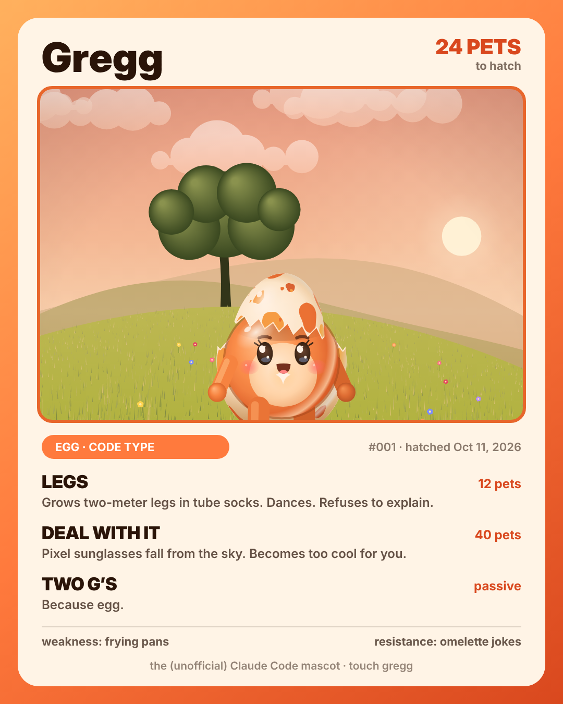

There is an egg in a field. You pet it. It likes that.

Pet it enough and it starts to crack. Keep going and something hatches. His name is **Gregg**. Two g's, because egg.

He wears his own shell as a hat. He applied to be the Claude Code mascot and never waited for a reply. He would like more pets, please.

**Gregg facts**

- Type: egg / code
- Hatched: October 11, 2026
- Likes: pets, tube socks, golden hour, `git push`
- Dislikes: frying pans, omelette jokes, being called "the egg guy"
- Special move: **Legs**
- Catchphrase: *it works on my egg*

<br clear="right">

## Things to try

- **Pet the egg.** Move the tiny hand over it. Three cracks, then a hatch.
- **Brush the grass.** It parts under your hand and slowly springs back.
- **Change the time of day.** Morning, Golden and Night. Night has fireflies.
- **Listen to Gregg.** He talks. Mostly about pets. Sometimes about shipping.
- **Share your Gregg.** There's a button for that once he hatches.

<details>
<summary><b>Secrets (spoilers)</b></summary>

<br>

- Every **12 pets**, Gregg grows two-meter legs in tube socks and dances.
- At **40 pets**, pixel sunglasses fall from the sky. He becomes too cool for you.
- Type **`gregg`** anywhere. He'll say hi.
- Type **`legs`**. You know what happens.
- Type **`cool`** to toggle the sunglasses.
- Open the browser console.

</details>

## Gregg's sticker pack

<p align="center">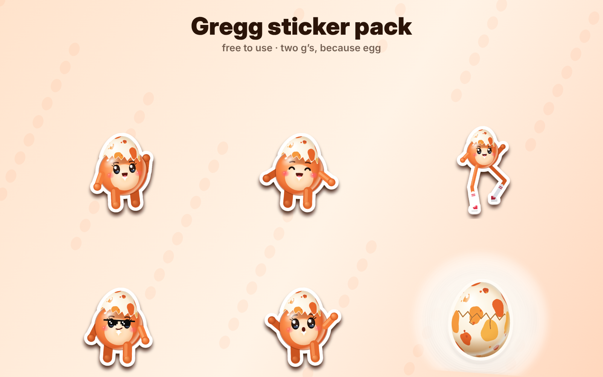</p>

Transparent PNGs, free to use: [hi](assets/stickers/gregg-hi.png) · [love](assets/stickers/gregg-love.png) · [legs](assets/stickers/gregg-legs.png) · [deal with it](assets/stickers/gregg-deal-with-it.png) · [shook](assets/stickers/gregg-shook.png) · [egg](assets/stickers/egg.png)

## Memes

<table>
<tr>
<td>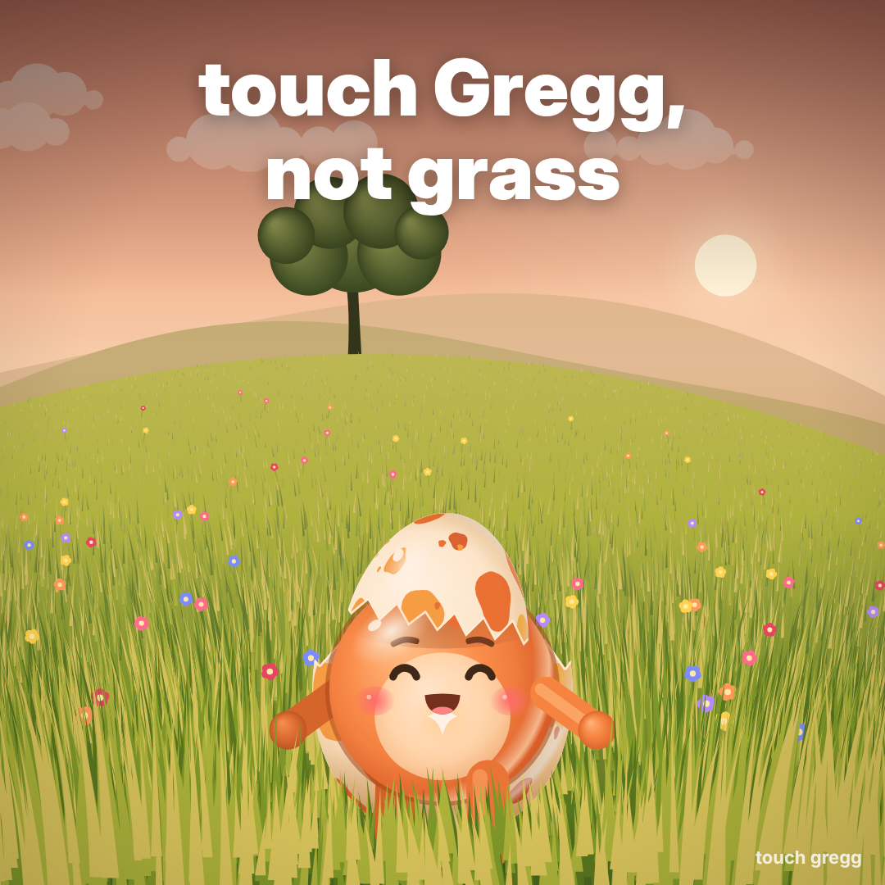</td>
<td>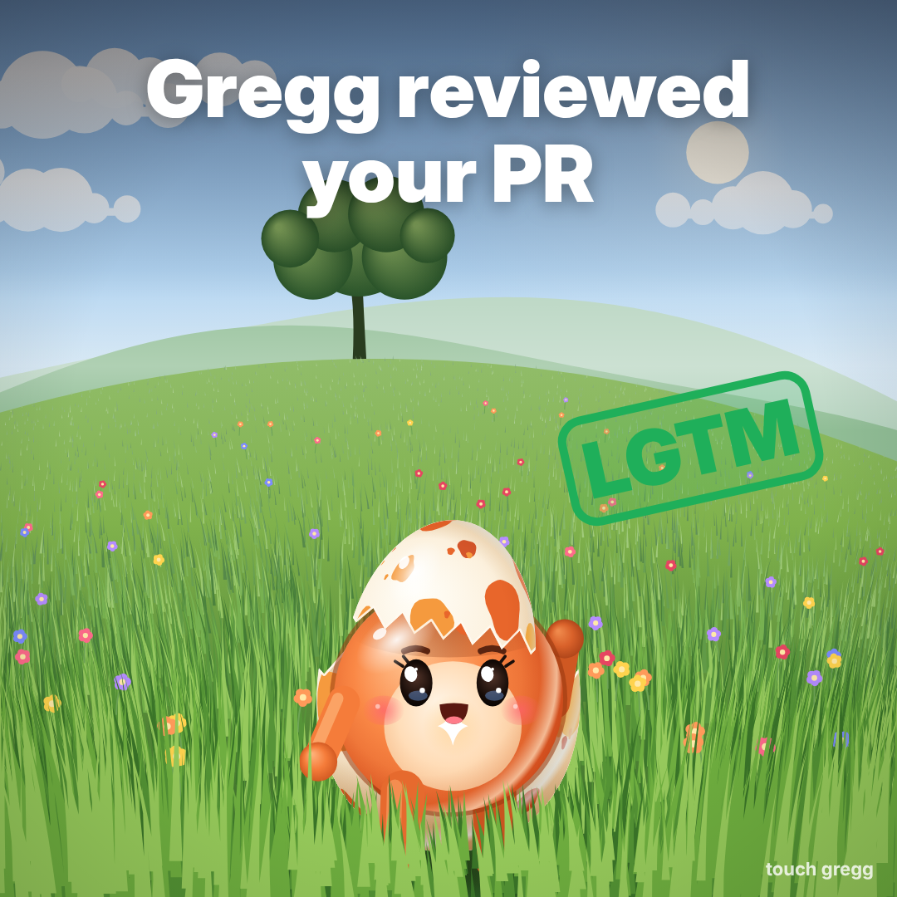</td>
<td>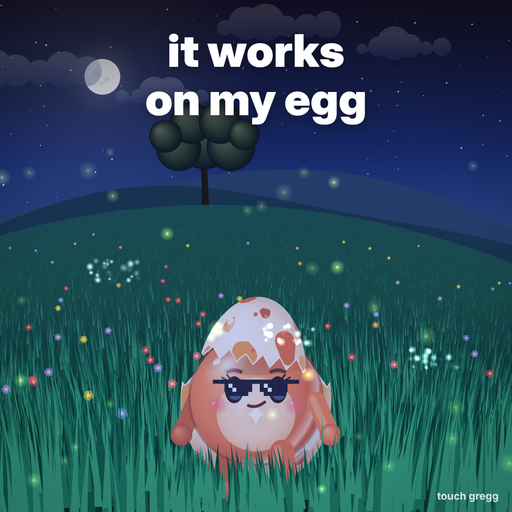</td>
</tr>
<tr>
<td>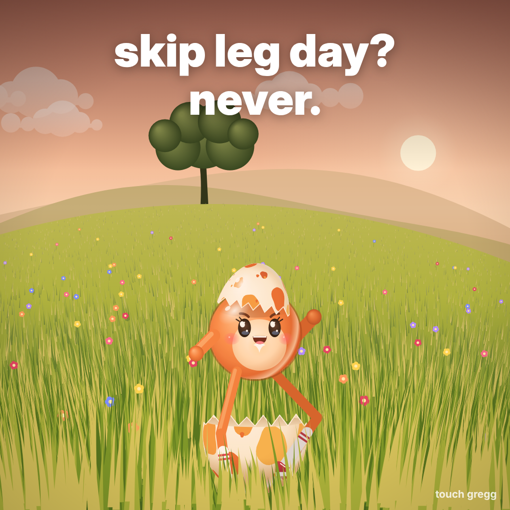</td>
<td>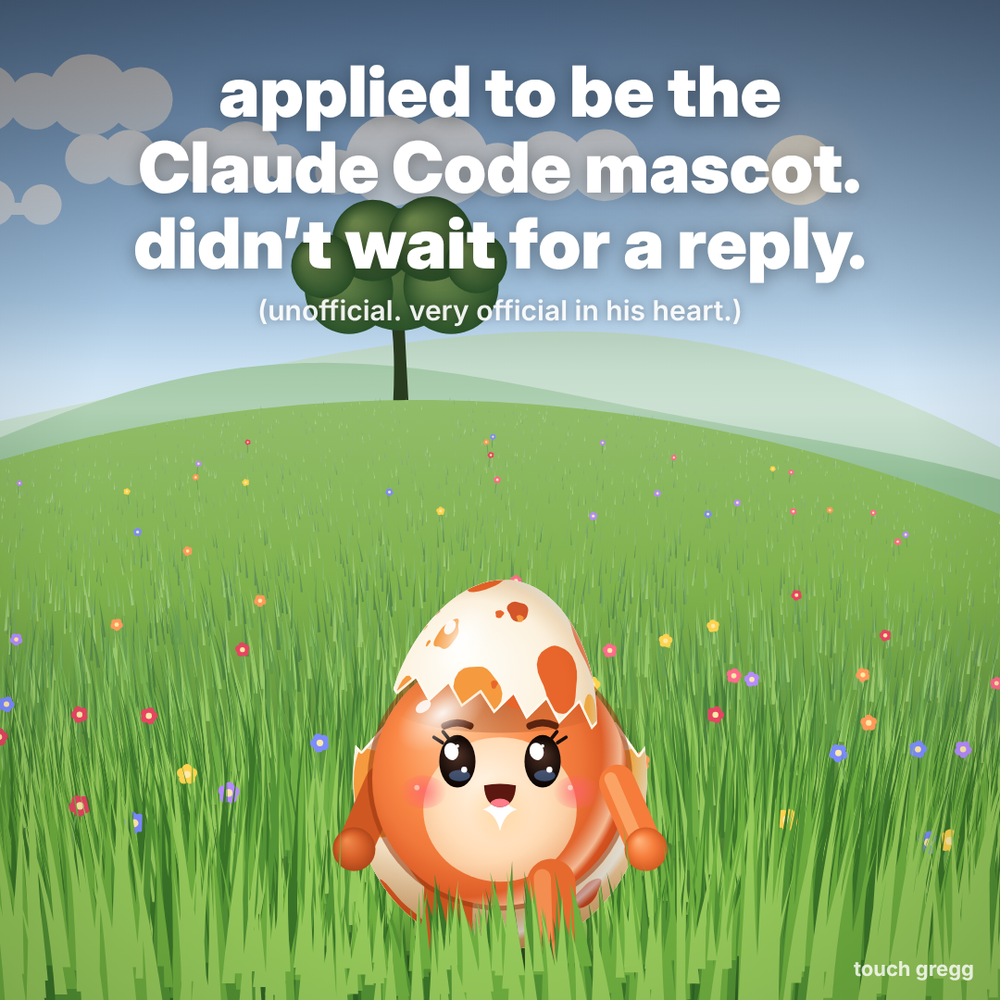</td>
<td>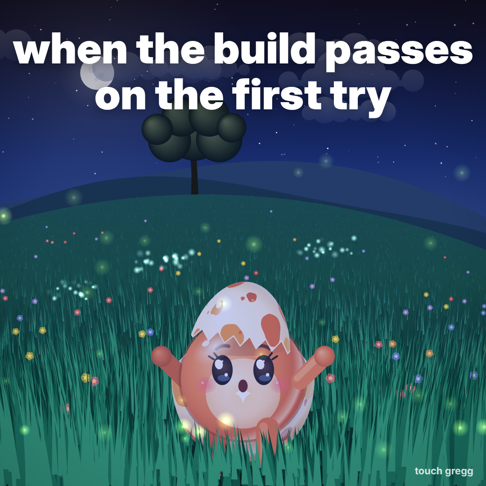</td>
</tr>
</table>

Reaction GIF for your PR comments:

<p align="center">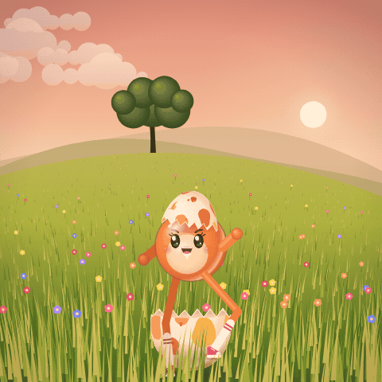</p>

## Wallpapers

| Phone | Desktop |
| --- | --- |
| 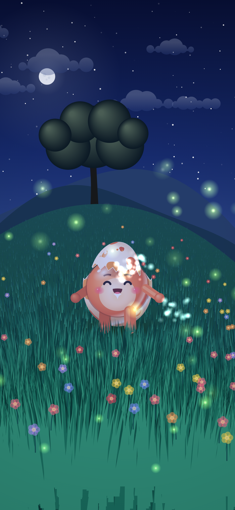 | 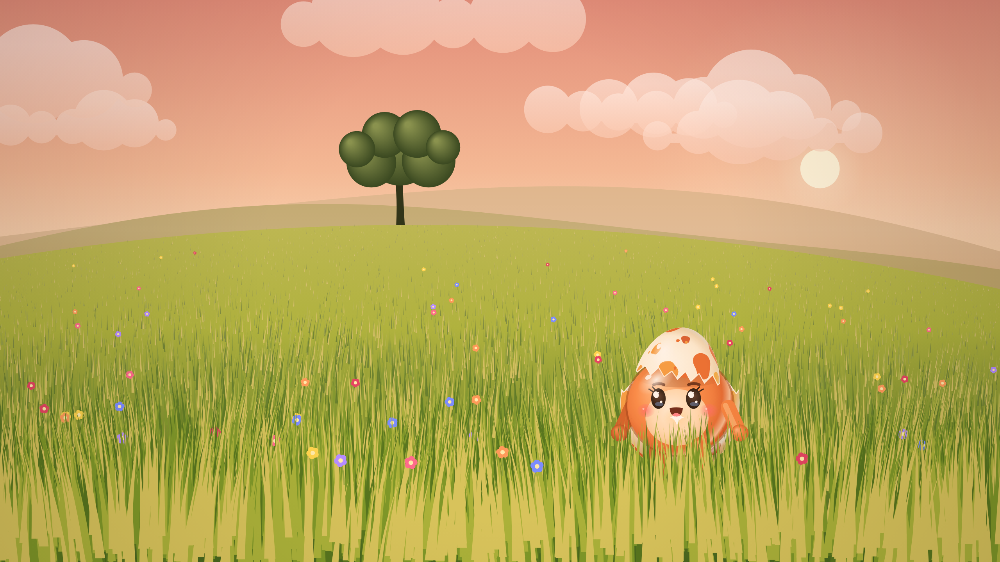 |
| [1170×2532](assets/creatives/wallpaper-phone.png) | [2560×1440](assets/creatives/wallpaper-desktop.png) |

Avatars: [Gregg](assets/avatar-gregg.png) · [Egg](assets/avatar-egg.png) · Header for X: [1500×500](assets/banner-x.png)

## FAQ

**Is Gregg the official Claude Code mascot?**
No. He's an unofficial fan mascot. He doesn't know that, and nobody has the heart to tell him.

**Why two g's?**
Because egg.

**Can I eat Gregg?**
Absolutely not.

**What happens at 41 pets?**
Nothing. He's just happy.

**Will Gregg remember me?**
Yes. Your Gregg is saved in your browser. Hit *New egg* to start over (he'll understand).

## How it's made

No game engine, no 3D library, no image files for the scene, no audio files.

- Every blade of grass, the egg, Gregg, the sky and the fireflies are drawn with the Canvas 2D API, frame by frame.
- Every sound is synthesized live with the Web Audio API.
- [`gregg.js`](gregg.js) draws the egg and Gregg. [`app.js`](app.js) runs the field, the petting, the talking and the sounds.

Built with Claude Opus 5.5.

## Run it locally

```bash
git clone https://github.com/MyWestLord/touch-gregg
cd touch-gregg
python3 -m http.server 8000
# open http://localhost:8000
```

## Disclaimer

Gregg is an unofficial fan mascot. This project is not affiliated with, endorsed by or sponsored by Anthropic. Claude and Claude Code are trademarks of Anthropic.

## License

Code: [MIT](LICENSE). Art in `assets/`: free to use, credit appreciated. Fonts: [Inter](https://github.com/rsms/inter), SIL Open Font License 1.1 (see `fonts/LICENSE-Inter.txt`).
